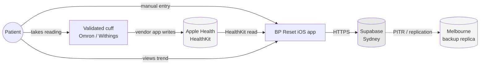
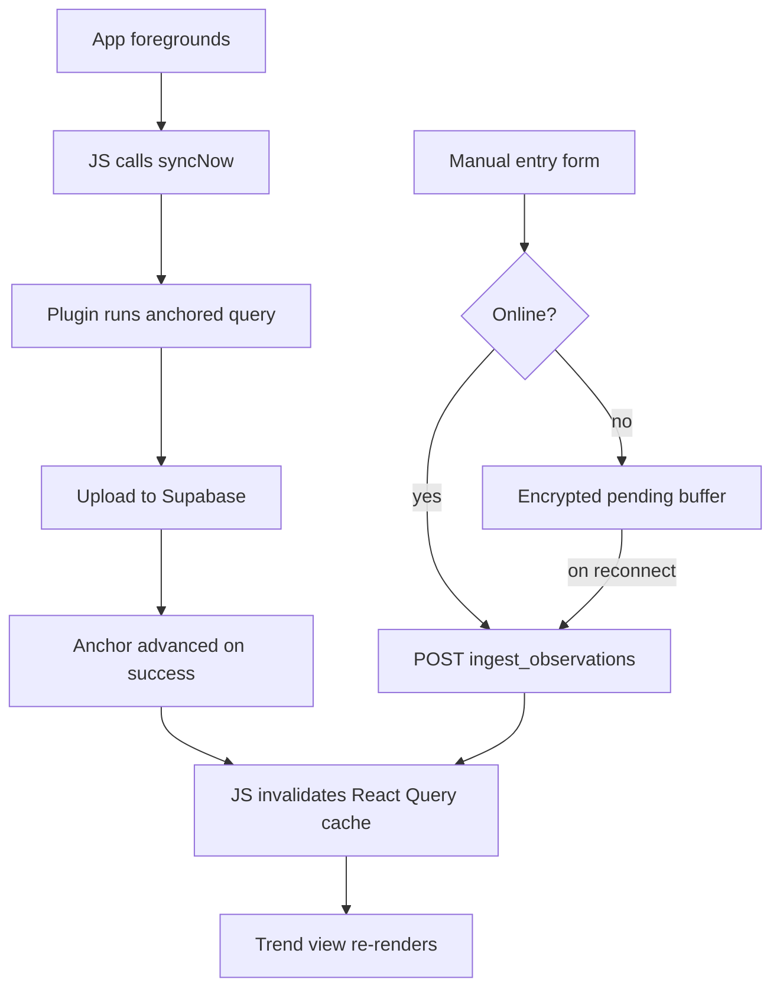

# BP Reset V1 — System Architecture

**Status** | Draft for team review |
**Owner** | Ben (platform / architecture) |
**Version** | 0.1 |
**Date** | 29 July 2026 |
**Contract refs** | SOW-2026-001 A.3, A.3.3, A.3.4, A.12, A.13; Annexure D D.11 |
**Related docs** | `02-data-model-and-api.md`, `03-plugin-bridge-spec.md` |

## 1. Purpose

This document is the shared mental model for the BP Reset V1 build. It defines the components, the boundaries between them, and the path a blood-pressure reading takes from cuff to screen.

It exists because three workstreams run in parallel and only meet in Stage 4. Luca builds the native HealthKit plugin in isolation; Michael and Ben build the app foundation; the two are joined late. Everything in this document that describes a boundary is a contract between those tracks and changes only by agreement.

## 2. Non-negotiable build constraints

These are contractual (SOW A.3.3, A.13.5). They are not style preferences and they are not subject to a good idea in a standup.

The Solution **must not**:

- interpret a reading, or classify it as high, normal or low
- apply a clinical threshold, colour zone or band
- raise an alert or notification whose content depends on a reading value
- calculate a risk score, heart-age or equivalent metric
- transmit a reading to a clinician for monitoring
- use traffic-light colours anywhere in the interface

Anything on this list is a Variation under A.10.2 and requires Corveo's regulatory contractor to clear it before it is built.

Additionally, and for the same class of reason:

**No third-party analytics, crash reporting or telemetry SDKs.** The Engagement Data Schedule records zero sub-processors. Adding Sentry, Firebase or equivalent requires prior disclosure under Annexure D clause D.5 and Andrew's sign-off. Not a code review conversation.

Validation copy is mechanical, never evaluative. `"Please check this value"` is fine. `"That reading is very high"` is a breach.

## 3. Context

Apple Health has no cloud API. Its data is on-device and reachable only through a native iOS app. That single constraint determines the shape of the whole system: the app is the only possible gateway, and there is no server-to-server route.

## 4. Components

| Component | Technology | Owner | Notes |
|---|---|---|---|
| Native shell | Capacitor 6, Swift | Luca | Hosts the WebView and the HealthKit plugin |
| HealthKit plugin | Swift, custom Capacitor plugin | Luca | See `03-plugin-bridge-spec.md` |
| App UI | React 18, TypeScript, Vite | Michael | Runs in the WebView |
| Design system | Placeholder → Userkind Figma components | Michael | Semantic tokens only; see §8 |
| Backend | Supabase (Postgres 15, PostgREST, GoTrue) | Ben | Sydney region, Corveo's account |
| Build pipeline | GitHub Actions + Fastlane | Luca | Builds produced by AI Please, distributed through Corveo's Apple Developer account |

There are no Edge Functions in V1. Ingest is a Postgres RPC; reads are PostgREST against views. Rationale in `02-data-model-and-api.md` §5.

## 5. Data flow

### 5.1 Background sync (HealthKit path)

The critical property: **HealthKit is the durable queue.** The plugin does not advance its `HKQueryAnchor` until Supabase confirms the write. A failed upload leaves the samples unread and the next wake retries them. There is no local copy of health data on the device.

sequenceDiagram
    autonumber
    participant iOS as iOS
    participant HK as HealthKit
    participant N as Native plugin
    participant KC as Keychain
    participant SB as Supabase

    Note over iOS,N: PHASE 1 — Wake App is backgrounded or terminated

    iOS->>N: Observer query fires on bloodPressureSystolic
    N->>N: Start background task assertion

    Note over N,KC: PHASE 2 — Restore state

    N->>KC: Read stored HKQueryAnchor (per userId)
    KC-->>N: anchor or nil
    N->>KC: Read accessToken + refreshToken
    KC-->>N: token pair or nil

    alt No credentials
        N->>N: Set lastError = NO_CREDENTIALS
        N->>iOS: completionHandler()
        Note over N,iOS: Exit — anchor untouched
    else Credentials present

        Note over N,HK: PHASE 3 — Read from HealthKit

        N->>HK: HKAnchoredObjectQuery (correlationType: bloodPressure, anchor)
        HK-->>N: [HKCorrelation], [HKDeletedObject], newAnchor

        alt No new samples and no deletions
            N->>iOS: completionHandler()
            Note over N,iOS: Exit — nothing to send
        else Work to do

            Note over N: PHASE 4 — Normalise

            N->>N: Extract correlation.uuid → source_uuid
            N->>N: Extract sample.uuid ×2 → component source_uuid
            N->>N: Read metadata: TimeZone, WasUserEntered
            N->>N: Read sourceRevision + HKDevice
            N->>N: Build ingest payload (no interpretation applied)

            Note over N,SB: PHASE 5 — Ensure valid session

            alt Access token expired
                N->>SB: POST /auth/v1/token?grant_type=refresh_token
                alt Refresh succeeds
                    SB-->>N: new accessToken + rotated refreshToken
                    N->>KC: Persist rotated pair
                else Refresh fails
                    SB-->>N: 401 / unreachable
                    N->>N: Set lastError = AUTH_REFRESH_FAILED (retryable)
                    N->>iOS: completionHandler()
                    Note over N,HK: Exit — anchor HELD, samples redelivered
                end
            end

            Note over N,SB: PHASE 6 — Upload

            N->>SB: POST /rest/v1/rpc/ingest_observations {observations[], deleted_source_uuids[]}
            SB->>SB: Verify active consent row
            SB->>SB: Upsert on (user_id, source_system, source_uuid)
            SB->>SB: Validate bounds from observation_definition
            SB->>SB: Soft-delete matched source_uuids
            SB->>SB: Write audit_event rows

            Note over N,SB: PHASE 7 — Commit or hold

            alt 2xx — success
                SB-->>N: {inserted, duplicates, soft_deleted, rejected[]}
                N->>KC: Persist newAnchor
                N->>N: lastSuccessfulSyncAt = now
                N->>N: Emit syncCompleted to JS (if attached)
                N->>iOS: completionHandler()
                Note over KC: Anchor ADVANCED — samples never re-read
            else 403 CONSENT_REQUIRED
                SB-->>N: 403
                N->>N: lastError = CONSENT_REQUIRED (not retryable)
                N->>iOS: completionHandler()
                Note over HK: Anchor HELD — awaits consent, then redelivered
            else 4xx — payload rejected
                SB-->>N: 400 / 422
                N->>N: lastError = UPLOAD_REJECTED (not retryable)
                N->>N: Emit syncFailed to JS
                N->>iOS: completionHandler()
                Note over HK: Anchor HELD — surfaced on next foreground
            else 5xx / timeout / no network
                SB-->>N: error or no response
                N->>N: lastError = UPLOAD_FAILED (retryable)
                N->>iOS: completionHandler()
                Note over HK: Anchor HELD — same samples redelivered next wake
            end
        end
    end

    

Consequences to hold in mind:

- iOS throttles observer background wakes. Design for roughly hourly, never promise near-real-time in copy or to Andrew.
- Observer queries must be re-registered on **every app launch** from the native launch path, not from JS. Background delivery survives reboot; observers do not.
- The plugin needs a valid Supabase session while the WebView is suspended. Tokens live in Keychain with `kSecAttrAccessibleAfterFirstUnlockThisDeviceOnly` and `kSecAttrSynchronizable = false`.

### 5.2 Foreground sync and manual entry

**Open item — manual entry offline buffer.** Manual entries do not exist in HealthKit, so they have no durable fallback. To implement 

A minimal encrypted pending-write buffer in Capacitor Preferences, holding only unsent entries, cleared on confirmed write. This is the one narrow exception to "no health data at rest on device" and must be described in the Security Baseline.

## 6. Trust boundaries and the Model B line

Under Annexure D, this engagement is **Model B**. AI Please holds no identifiable Client Data at any time:

- no administrative credentials to the production data store
- no data-plane read access to identifiable Client Data
- no ability to trigger an export of identifiable Client Data
- development, testing and review on seeded or synthetic data only

Ben holds developer access to Corveo's Supabase organisation for migration deployment. Migrations are versioned SQL in the repository, reviewed, and applied through CI using a credential held in Corveo's secrets. The mechanism is documented in the Security Baseline; it is not improvised at the terminal.

**On-device storage note.** The patient's phone sits outside both defined environments — it is neither the Client Environment (A.1.2) nor an AI Please system (D.11). Because the design holds no health data at rest on device, this is a description gap rather than an exposure. The Security Baseline states it explicitly.

## 7. Environments

| Environment | Owner | Data | Purpose |
|---|---|---|---|
| `dev` | AI Please | Synthetic only | Day-to-day build, schema iteration |
| `staging` | Corveo | Synthetic only | Mirrors prod config, feeds TestFlight |
| `prod` | Corveo, Sydney | Real patient data | Live, with Melbourne backup replica |

No identifiable data ever enters `dev` or `staging`. Seeded datasets are defined in `02-data-model-and-api.md` §9.

## 8. Design system swap

Michael builds against a placeholder system that will be replaced by Userkind's Figma components after the joint session. The swap must be mechanical, not a rebuild.

Rules:

- Components consume **semantic tokens only** (`--color-surface`, `--space-md`, `--type-body`). No raw hex, no raw px, anywhere in component code.
- Every third-party or system component sits behind a thin local wrapper.
- The token vocabulary is defined **before** the Userkind session, so we ask them to map to ours rather than the reverse.
- No traffic-light or severity colours in the palette at all — the constraint in §2 is enforced at the token layer, not by discipline.

Every user-facing product string lives in a constants module. `My Heart Record` has an unresolved trade mark clearance question that is Corveo's to run; a rename must be a one-file change.

## 9. Key architectural decisions

| # | Decision | Rationale | Alternative rejected |
|---|---|---|---|
| A-01 | Native iOS app as sole data gateway | Apple Health has no cloud API | Server-to-server ingest — not possible |
| A-02 | HealthKit is the durable queue; anchor advances only on 2xx | Removes on-device health data entirely; no lost readings | Local SQLite outbox — creates a shadow health record and an iCloud backup risk |
| A-03 | Native uploads directly to Supabase in background | WebView is suspended during background wakes | JS-mediated upload — silently drops background readings |
| A-04 | PostgREST + RLS for reads; single RPC for ingest | No extra deploy target; validation lives beside the constraints that enforce it | Edge Functions — unnecessary without a client-inaccessible secret |
| A-05 | Parent/child observation model | Contractual requirement A.3.4; matches AU Core and HealthKit structure | Flat BP table — fails the migration-safe requirement |
| A-06 | Soft delete only, with audit log | A.12.6 deletion-with-logging against health-records floor | Hard delete — breaches the retention obligation |
| A-07 | No third-party SDKs | Engagement Data Schedule records zero sub-processors | Sentry / Firebase — requires D.5 disclosure and Andrew's sign-off |

Decisions are appended to `docs/decisions.md` as they are made. This table carries only the ones that shape the architecture.

## 10. Deferred

Named here so they do not creep in: Android and Google Health Connect parity; a cloud aggregator (Terra et al.); direct vendor cloud APIs; OCR of printed cuff displays; AI educational summaries; My Health Record or any external clinical system integration; clinician dashboard; push notification infrastructure; writing back to Apple Health.

## 11. Open items

| # | Item | Owner | Blocks |
|---|---|---|---|
| O-01 | Melbourne replica: written residency confirmation and cost | Ben / Andrew | Security Baseline |
| O-02 | Userkind session scheduled; token vocabulary agreed | Ben / Michael | Design system swap |
| O-03 | Data Schedule amended to describe on-device transient state | Nick / Andrew | Signature |
