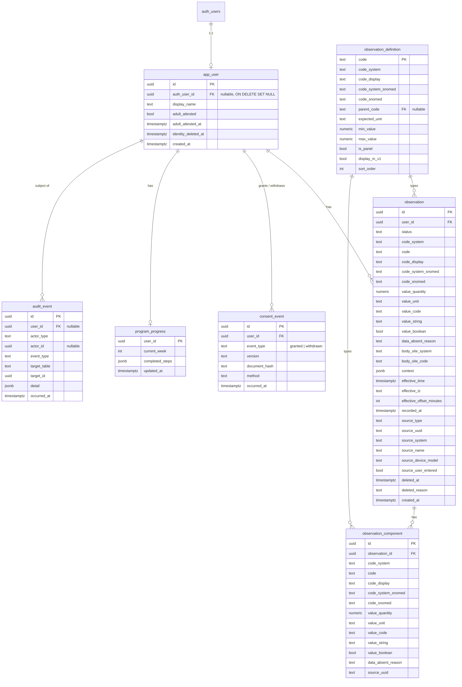
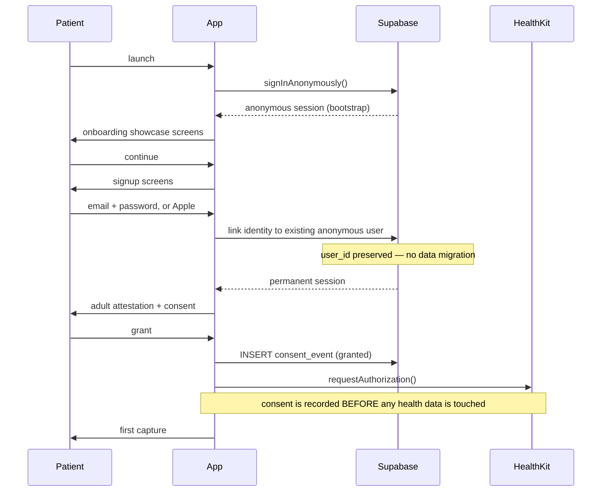

# BP Reset V1 — Data Model, FHIR Mapping, API and Auth

| | |
|---|---|
| **Status** | Draft for team review |
| **Owner** | Ben (platform) |
| **Version** | 0.2 |
| **Date** | 29 July 2026 |
| **Changes in 0.2** | Added `app_user.auth_user_id`; `consent` replaced by append-only `consent_event`; `deleted_by` removed from `observation`; `observation_definition` gains `parent_code`, `code_system_snomed`, `sort_order`; `audit_event` gains `actor_type`/`actor_id`; new §1.4 field reference |
| **Contract refs** | SOW-2026-001 A.3 (Deliverables 4, 9, 10, 11, 12, 13), A.3.4, A.12, A.13.5; Annexure D D.4, D.11 |
| **Consumers** | Michael (API + views), Luca (ingest contract), Nick (Security Baseline, Deliverable 10 acceptance) |

---

## Part 0 — Scope and language

This document covers the Supabase data model, its mapping to FHIR AU Core, the API surface, auth and session handling, and the environment/configuration matrix.

**A wording point that matters commercially.** SOW clause A.3.4 commits AI Please to *"a generic observation model (subject, observation type and code, value, unit, source, timestamp, provenance)"* that is migration-safe for later result types. It does **not** commit to FHIR conformance. FHIR AU Core appears only in Corveo's own Engineering Brief, which is not a contract instrument.

Deliverable 10 is acceptance-gated. Accordingly, this design and all client-facing material describe the schema as **AU Core-mappable**, and demonstrate the mapping. We do not claim conformance, because strict conformance requires an AU Core Patient resource with demographics V1 does not collect. Mappable exceeds the contract; conformant would create a warranty we cannot fully meet at acceptance.

---

## Part 1 — Data model

### 1.1 Shape

Two tables carry all clinical data:

- `observation` — the parent. Carries subject, code, effective time, status, source and provenance.
- `observation_component` — the child. Carries a coded sub-measurement with its own value and unit.

A blood pressure reading is **one parent with two components**. A heart rate or a body weight is **one parent with a direct value and no components**. A future lipid panel is one parent with four components. Nothing in the schema is blood-pressure-specific.



### 1.2 Decisions and why

**Parent/child rather than flat.** A flat `readings(systolic, diastolic, pulse)` table cannot satisfy A.3.4's requirement that later result types be added "without migrating live patient data or reworking existing read paths." It also mismatches both AU Core (which mandates `component` at 2..* for BP and says `Observation.value[x]` SHOULD be omitted) and HealthKit (which stores BP as a correlation containing two child samples). The join cost is absorbed by read views (§5.3); Michael never sees it.

**Polymorphic value columns with a check constraint.** `value_quantity` alone covers BP and most labs but breaks on qualitative results — positive/negative, "trace" — which the Cholesterol module will hit. Exactly one value column is populated, or `data_absent_reason` is set, enforced by constraint. Cheap now, impossible to retrofit once live data exists.

**Codes denormalised inline, plus a definitions table.** Codes are immutable, so denormalising is safe, and a self-describing row exports to FHIR without a join — which is what makes the export deliverable nearly free. `observation_definition` holds expected units and validation bounds so that adding cholesterol is a row insert rather than a code change.

**Dual coding is mandatory.** AU Core requires `Observation.code.coding` at cardinality **2..\*** — a LOINC coding *and* a SNOMED CT coding, both 1..1, at both panel and component level. This is an Australian addition; base FHIR requires LOINC only. Corveo's Engineering Brief lists LOINC codes alone, so building to that brief would not be mappable. Every observation type carries both codes from day one.

**Four timestamps.** `effective_time` is the UTC instant of measurement; `effective_tz` is the IANA name; `effective_offset_minutes` supports emitting a conformant `dateTime`; `recorded_at` is when it entered the system; `created_at` is when the row was written. Time-of-day is clinically meaningful for BP and patients travel — derive local time from the IANA name, never from UTC, or DST and travel scramble the tags.

**`body_site` is a first-class column.** It maps to `Observation.bodySite`, bound in AU Core to the Australian NCTS value set. It will be **null for every HealthKit-sourced reading** — HealthKit has no standard metadata key for cuff arm or posture — and populated only on manual entry. The trend view must treat a missing body site as normal, not as an error. Posture stays in `context` jsonb; AU Core expresses sitting/standing/lying by adding qualifying SNOMED codes to `Observation.code`, which is the documented extension point rather than a column.

**Soft delete only.** SOW A.12.6 commits the Solution to retention against the health-records floor by deletion-with-logging, not unconditional deletion. The floor derives from the NSW *Health Records and Information Privacy Act 2002*. There is therefore no `DELETE` on `observation` in this system. RLS excludes soft-deleted rows from every patient-facing read; hard deletion is a privileged operation Corveo performs.

**Identity deletion is separate from record deletion.** App Store Guideline 5.1.1(v) requires in-app account deletion for any app supporting account creation. That collides with the retention floor. Resolution: `app_user` sits between `auth.users` and every clinical table. `app_user.auth_user_id` is nullable with `ON DELETE SET NULL`, so deleting the auth identity nulls the link, sets `identity_deleted_at` and clears `display_name`, while the `app_user` row and all clinical rows survive under the legal obligation. **No clinical table references `auth.users` directly.** Without the intervening `auth_user_id` column this resolution does not work — we would be forced to choose between breaching Apple's rule and breaching the retention floor. The privacy notice states the outcome plainly.

**Consent is an append-only event log, never an updated row.** `consent_event` records `granted` and `withdrawn` as separate immutable rows; current state is computed by `v_consent_status` from the latest event. Corveo carries the APP 3.3 express-consent obligation for health information and the APP 5 collection-notice obligation. If Corveo is ever asked to demonstrate what a given patient agreed to on a given date, a row that has been overwritten cannot answer. `document_hash` is a SHA-256 of the exact consent text bundled with the app build, so we can prove which words were shown rather than only that a box was ticked.

**`audit_event` is the single source for who did what.** An earlier draft placed `deleted_by` on `observation`; it is removed. Actor attribution lives in `audit_event` only, so there is one authoritative record rather than two that can disagree. This satisfies A.12.6's deletion-with-logging, Annexure D clause D.4's logging requirement, and the logging item in the Security Baseline, which is itself acceptance-gated.

**No column can hold an interpretation.** There is no `category`, `severity`, `band`, `is_high` or `risk_score` anywhere in the schema, and none may be added. The A.3.3 bright line is enforced architecturally: adding a colour zone would require a migration and a review, not the setting of a flag that already exists.

**Adults only.** V1 restricts to 18+ with an attestation at signup (`adult_attested`, `adult_attested_at`). This removes the second limb of the retention floor ("until the individual turns 25 if collected as a minor") without collecting a date of birth we have no other use for — which is also the APP 3 data-minimisation position. Consent copy reflects the restriction.

**Heart rate captured, not displayed.** Stored as its own observation (LOINC 8867-4), never as a BP component — HealthKit and AU Core both keep it separate. `observation_definition.display_in_v1 = false`. The HealthKit read permission is requested and disclosed in the consent copy.

### 1.3 Reference data (`observation_definition` seed)

| code | display | snomed | parent | unit | min | max | panel | display_v1 | sort |
|---|---|---|---|---|---|---|---|---|---|
| `85354-9` | Blood pressure panel | `75367002` | — | — | — | — | yes | yes | 10 |
| `8480-6` | Systolic BP | `271649006` | `85354-9` | `mm[Hg]` | 60 | 260 | no | yes | 11 |
| `8462-4` | Diastolic BP | `271650006` | `85354-9` | `mm[Hg]` | 30 | 160 | no | yes | 12 |
| `8867-4` | Heart rate | *verify against AU Core Heart Rate profile* | — | `/min` | 30 | 220 | no | **no** | 20 |

`parent_code` lets ingest reject a component arriving without its panel — a bare `8480-6` with no `85354-9` parent is malformed and returns `MISSING_COMPONENT` rather than being stored as an orphan.

Cross-field rule enforced in the ingest RPC, not as a column constraint: systolic must exceed diastolic.

Validation is **data quality, not clinical interpretation** (SOW Deliverable 4). Rejection copy is fixed and mechanical:

```
"Please check this value."
"Systolic should be higher than diastolic."
```

No copy may reference whether a value is high, low, normal or concerning. These exact strings live in the copy constants module so nobody improvises at the keyboard.

### 1.4 Field reference

Every column, and the reason it exists. This section is the substance of Deliverable 10 — it is what demonstrates the generic observation model required by A.3.4 rather than asserting it.

#### `auth.users` — Supabase-managed

Not ours. Holds email, password hash, linked identities (Apple), and `is_anonymous`. We neither define nor extend it.

The decision that matters is what we do **not** do with it: no clinical table references it. See the identity-deletion decision in §1.2.

#### `app_user` — the durable subject

Exists so there is one stable identifier for a patient that outlives their login.

| Field | Why it is needed |
|---|---|
| `id uuid PK` | The subject every observation points at. Never reused, never deleted. Maps to `Observation.subject`. |
| `auth_user_id uuid FK NULL` | Link to `auth.users`, `ON DELETE SET NULL`. Nulled on account deletion; this row survives. |
| `display_name text` | Greeting copy, and the only demographic held. Cleared on identity deletion. |
| `adult_attested bool` | The 18+ gate. Without it the adults-only retention position is unsupported. |
| `adult_attested_at timestamptz` | Evidentiary — proves *when* the attestation was made, which is what matters if the retention basis is questioned. |
| `identity_deleted_at timestamptz` | Distinguishes "account deleted, record retained under law" from an active patient. Keeps the privacy notice accurate. |
| `created_at timestamptz` | Start of the retention clock. |

RLS resolves `auth.uid()` → `app_user.id` through a stable helper function rather than repeating the join in every policy.

Deliberately absent: `email` (lives in `auth.users`; duplicating it duplicates a deletion obligation) and `date_of_birth` (the adults-only decision removes the need, and not collecting it is the APP 3 position).

#### `observation` — the parent record

One row per clinical event. BP, heart rate, and every roadmap module land here identically.

**Identity and subject**

| Field | Why |
|---|---|
| `id uuid PK` | Internal. |
| `user_id uuid FK → app_user.id` | The subject. `NOT NULL`. |
| `status text` | FHIR `Observation.status` is 1..1 with a required binding. Always `final` in V1, but the column must exist — `amended` and `entered-in-error` become meaningful the moment corrections are supported. |

**Coding — four columns, not two**

| Field | Why |
|---|---|
| `code_system text` | Fixed `http://loinc.org`. |
| `code text` | e.g. `85354-9`. |
| `code_display text` | Human label, denormalised so a row is self-describing on export. |
| `code_system_snomed text` | Fixed `http://snomed.info/sct`. |
| `code_snomed text` | e.g. `75367002`. |

The SNOMED pair is mandatory, not decoration — see the dual-coding decision in §1.2.

**Value — polymorphic, and null for BP**

| Field | Why |
|---|---|
| `value_quantity numeric` | Numeric results: heart rate, weight, ApoB. |
| `value_unit text` | UCUM code for the above. |
| `value_code text` | Coded qualitative results — positive/negative. Cholesterol will need this. |
| `value_string text` | Free-text results from future lab imports. |
| `value_boolean bool` | Boolean results. |
| `data_absent_reason text` | FHIR requires recording *why* a value is missing rather than dropping the field. |

For a BP panel **all of these are null**, because AU Core states `Observation.value[x]` SHOULD be omitted when components carry the values. They exist for single-value observation types and for the roadmap modules. A check constraint enforces exactly one of: a populated value column, `data_absent_reason`, or panel status.

**Context**

| Field | Why |
|---|---|
| `body_site_system` / `body_site_code text` | `Observation.bodySite`, bound to the NCTS `body-site-1` value set. **Always null for HealthKit** — no standard metadata key carries cuff arm. Manual entry only. |
| `context jsonb` | Posture, time-of-day tag, cuff size, under documented keys. Posture stays here because AU Core expresses sitting/standing/lying by adding qualifying SNOMED codes to `Observation.code`, not as a separate element. |

Body site being permanently null for HealthKit readings is expected behaviour, not a defect. The trend view renders it as absent, never as an error.

**Time — four columns because they are four different facts**

| Field | Why |
|---|---|
| `effective_time timestamptz` | UTC instant of measurement → `Observation.effectiveDateTime`. |
| `effective_tz text` | IANA name from `HKMetadataKeyTimeZone`. Derive local time from this, never from UTC. |
| `effective_offset_minutes int` | FHIR `dateTime` carries an offset; storing it avoids recomputing DST at export. |
| `recorded_at timestamptz` | When it entered our system. Differs sharply from `effective_time` during the 30-day backfill. |
| `created_at timestamptz` | Row write time. Debugging and audit. |

**Provenance — named as an explicit inclusion in A.3.4**

| Field | Why |
|---|---|
| `source_type text` | `healthkit` \| `manual`. |
| `source_uuid text` | `HKCorrelation.uuid`, or client-generated for manual. Half the dedup key, and the deletion-matching key. |
| `source_system text` | `sourceRevision.source.bundleIdentifier` — stable across app renames, unlike the display name. |
| `source_name text` | Display only, e.g. "OMRON connect". |
| `source_device_model text` | `HKDevice.model`. Frequently nil; cuffs vary in what they populate. |
| `source_user_entered bool` | `HKMetadataKeyWasUserEntered`. Distinguishes a device measurement from a value hand-typed into Apple Health — the highest-value provenance signal HealthKit provides. |

**Deletion**

| Field | Why |
|---|---|
| `deleted_at timestamptz` | Soft delete. A.12.6 permits no `DELETE` on this table. |
| `deleted_reason text` | `deleted_in_source` \| `patient_removed` \| `entered_in_error`. These need different handling and different patient-facing copy. |

There is no `deleted_by` column — actor attribution lives in `audit_event` alone (§1.2).

**Constraints and indexes**

- `UNIQUE (user_id, source_system, source_uuid)` — the dedup key. Makes every retry idempotent by construction, which is what allows the plugin to redeliver freely after a failed upload.
- `INDEX (user_id, effective_time DESC) WHERE deleted_at IS NULL` — serves keyset pagination and the trend aggregate.

#### `observation_component` — the child record

Exists because BP genuinely is a panel: AU Core sets `component` at 2..* with systolic and diastolic each 1..1, and HealthKit stores it the same way.

| Field | Why |
|---|---|
| `id uuid PK` | Internal. |
| `observation_id uuid FK` | Parent. Components have no independent existence. |
| `code_system` / `code` / `code_display` | LOINC — `8480-6` systolic, `8462-4` diastolic. |
| `code_system_snomed` / `code_snomed` | `271649006` / `271650006`. Mandatory at component level too. |
| `value_quantity` / `value_unit` | The number and `mm[Hg]`. |
| `value_code` / `value_string` / `value_boolean` | Present for future panels with qualitative components. |
| `data_absent_reason text` | AU Core requires both components present even when a value is missing — emit the component with a reason, never drop it. |
| `source_uuid text` | The `HKQuantitySample.uuid`. |

That last field carries more weight than its size suggests. `HKAnchoredObjectQuery` returns `HKDeletedObject` instances carrying **only a UUID**, and which UUID arrives depends on which type the deletion was observed against. Storing the correlation UUID alone means deletion handling silently fails for roughly half of cases. The ingest RPC matches deletions against parent **or** component `source_uuid`.

No `deleted_at` here — a component cannot be removed independently of its reading, so parent soft-deletion suffices. `UNIQUE (observation_id, code)` prevents two systolic components on one reading.

#### `observation_definition` — reference data, not clinical data

The table that makes adding Weight or Cholesterol a row insert rather than a code change. The module pricing argument, expressed as a schema object.

| Field | Why |
|---|---|
| `code text PK` | LOINC code. |
| `code_system` / `code_display` | Self-describing. |
| `code_system_snomed` / `code_snomed` | The AU Core second coding, held once centrally rather than hardcoded at every call site. |
| `parent_code text NULL` | Which panel a component belongs to. Lets ingest reject an orphan component. |
| `expected_unit text` | Ingest rejects any other unit. No conversion is performed in V1 — a silent transformation of a clinical value is pure downside risk. |
| `min_value` / `max_value numeric` | Data-quality bounds per Deliverable 4, data-driven so the rules live in one auditable place. |
| `is_panel bool` | Whether components are expected. |
| `display_in_v1 bool` | `false` for heart rate — captured, stored, not shown. |
| `sort_order int` | Deterministic ordering in exports and future list views. |

These bounds are **data quality, not clinical interpretation**. This table is the most likely place for someone to breach A.3.3 by adding a helpful `category` or `normal_range` column. Neither may be added.

#### `consent_event` — append-only

| Field | Why |
|---|---|
| `id uuid PK` | Internal. |
| `user_id uuid FK` | Subject. |
| `event_type text` | `granted` \| `withdrawn`. |
| `version text` | Consent document version. |
| `document_hash text` | SHA-256 of the exact text shown, bundled with the app build. Proves which words were displayed. |
| `method text` | `in_app_checkbox` — how consent was captured. |
| `occurred_at timestamptz` | When. |

Never updated, only inserted. `v_consent_status` computes current state from the latest event; the ingest RPC gates on it server-side, because UI ordering alone is not enforcement.

#### `audit_event` — append-only

| Field | Why |
|---|---|
| `id uuid PK` | Internal. |
| `user_id uuid FK NULL` | Nullable for system-level events. |
| `actor_type text` | `patient` \| `system` \| `corveo_admin`. Who caused it. |
| `actor_id uuid NULL` | Which one. |
| `event_type text` | `observation_ingested`, `observation_soft_deleted`, `consent_granted`, `consent_withdrawn`, `export_generated`, `identity_deleted`. |
| `target_table` / `target_id` | What was affected. |
| `detail jsonb` | Counts, rejection reasons, source system. |
| `occurred_at timestamptz` | When. |

Written inside the same transaction as the change it records, from security-definer functions only. Patients have no write policy on this table.

#### `program_progress`

| Field | Why |
|---|---|
| `user_id uuid PK FK` | One row per patient. |
| `current_week int` | Position in the six-week program. |
| `completed_steps jsonb` | Journey and education completion. |
| `updated_at timestamptz` | Last change. |

Server-side rather than device-local because it is a named data category in the Engagement Data Schedule and must survive reinstall and device change.

#### Deliberately absent

Absence is doing real work here and belongs in the design pack:

- **Any interpretation column** — no `category`, `severity`, `band`, `is_high`, `risk_score`. See §1.2.
- `date_of_birth` — adults-only decision.
- A duplicate `email` — lives in `auth.users`.
- Free-text patient notes — health information with additional breach surface, deferred.
- Any practitioner or clinician table — clinician transmission is out of scope (A.3.3) and the schema should not imply otherwise.

---

## Part 2 — FHIR AU Core mapping

Pinned to **AU Core v2.0.0 (R2)**, based on FHIR R4 (4.0.1). The Blood Pressure profile is unchanged since v1.0.0, so the pin is stable. Profile URL: `http://hl7.org.au/fhir/core/StructureDefinition/au-core-bloodpressure`.

### 2.1 Blood pressure panel

| Column | FHIR element | Card. | Fixed / notes |
|---|---|---|---|
| `status` | `Observation.status` | 1..1 | `final` |
| — | `Observation.category` | 1..* | system `http://terminology.hl7.org/CodeSystem/observation-category`, code `vital-signs` |
| `code` / `code_system` | `Observation.code.coding:BPCode` | 1..1 | `85354-9`, system `http://loinc.org` |
| `code_snomed` | `Observation.code.coding:snomedBPCode` | 1..1 | `75367002`, system `http://snomed.info/sct` |
| `user_id` | `Observation.subject` | 1..1 | Reference(AU Core Patient) — see §2.4 |
| `effective_time` + offset | `Observation.effectiveDateTime` | 1..1 | ISO 8601 with offset |
| — | `Observation.value[x]` | 0..1 | **omitted** — values live in components |
| `body_site_code` | `Observation.bodySite` | 0..1 | NCTS `body-site-1` value set, extensible |
| components | `Observation.component` | 2..* | Systolic 1..1, Diastolic 1..1 |

### 2.2 Components

| Component | LOINC | SNOMED | Value | Unit |
|---|---|---|---|---|
| Systolic | `8480-6` | `271649006` | `valueQuantity.value` (decimal, 1..1) | code `mm[Hg]`, system `http://unitsofmeasure.org` |
| Diastolic | `8462-4` | `271650006` | `valueQuantity.value` (decimal, 1..1) | code `mm[Hg]`, system `http://unitsofmeasure.org` |

Where a component value is genuinely absent, emit `component.dataAbsentReason` rather than dropping the component — the profile requires both components to be present regardless.

### 2.3 Provenance mapping

| Column | Source | FHIR |
|---|---|---|
| `source_type` | `healthkit` \| `manual` | `Observation.device` / extension |
| `source_uuid` | `HKCorrelation.uuid` or client UUID | dedup key; not exported |
| `source_system` | `sourceRevision.source.bundleIdentifier` | `Device.identifier` |
| `source_name` | `sourceRevision.source.name` | `Device.displayName` |
| `source_device_model` | `HKDevice.model` | `Device.modelNumber` |
| `source_user_entered` | `HKMetadataKeyWasUserEntered` | provenance extension |

`source_user_entered` distinguishes a device measurement from a value hand-typed into Apple Health. It is the highest-value provenance signal HealthKit provides and A.3.4 names provenance modelling as an explicit inclusion.

### 2.4 Known conformance gaps (state, don't solve)

1. **AU Core Patient.** `Observation.subject` must reference an AU Core Patient, which carries its own mandatory demographics. V1 collects a display name and email only. A strictly conformant export is therefore not possible — hence "mappable."
2. **SNOMED CT licensing.** Australian use is covered by the national NCTS licence; confirm before the codes appear in any exported artefact.
3. **Body site value set.** Arm codes must be drawn from the NCTS `body-site-1` value set, not chosen from SNOMED directly.

---

## Part 3 — Auth and session

### 3.1 Method

Supabase Auth with **email + password** as the primary method and **Sign in with Apple** implemented for launch. Magic link is rejected — the mail-app round trip mid-onboarding damages completion.

Note the App Store rule: offering a third-party social login makes Sign in with Apple mandatory. We are implementing it regardless, so this is not a constraint.

### 3.2 Flow



The anonymous session is a technical bootstrap only — it lets the app persist state before signup and preserves the user id through identity linking, so no data migration is required. It is converted at the signup screens, before consent and before HealthKit is approached.

### 3.3 Consent gating

Consent ordering is enforced **server-side**, not by UI sequence. Because `consent_event` is append-only, current state is the most recent event, not a nullable column:

```sql
-- helper: current consent state from the event log
create or replace function has_active_consent(p_user_id uuid)
returns boolean language sql stable as $$
  select coalesce(
    (select event_type = 'granted'
       from consent_event
      where user_id = p_user_id
      order by occurred_at desc, id desc
      limit 1),
    false
  );
$$;

-- inside ingest_observations
if not has_active_consent(v_user_id) then
  raise exception 'CONSENT_REQUIRED' using errcode = 'P0001';
end if;
```

Re-granting after withdrawal is simply another `granted` row. The history of both events is preserved, which is the point.

Withdrawal stops collection and blocks ingest; it does **not** delete existing data, because of the retention floor. The app informs the patient that without consent the application is limited, and re-prompts. The consent copy states the retention position plainly.

### 3.4 Session storage and lifetime

No Australian rule prescribes a session timeout. APP 11 and HRIP Act HPP 5 require "reasonable steps," not a specific duration, and there is no TGA or My Health Record angle. It is therefore our decision — and must be **documented in the Security Baseline as the reasonable-steps evidence**, because reasonableness is assessed against what was decided and why.

| Setting | Value | Reason |
|---|---|---|
| Access token TTL | 1 hour (Supabase default) | Standard |
| Refresh | Rotating refresh tokens | Limits replay window |
| Absolute expiry | None | Health tracking on a personal device; forced re-auth harms adherence |
| Storage | iOS Keychain via Capacitor secure-storage adapter | **Not** WebView localStorage — evictable, and inappropriate for health-app credentials |
| Keychain accessibility | `kSecAttrAccessibleAfterFirstUnlockThisDeviceOnly` | Readable by the plugin during background wakes; excluded from backup and iCloud Keychain |
| `kSecAttrSynchronizable` | `false` | Prevents iCloud Keychain sync |
| App lock | Optional Face ID / passcode gate | Cheap, disproportionate trust gain — offer to Andrew |
| Logout | Revoke refresh token, clear Keychain, clear `HKQueryAnchor` | Prevents cross-account contamination |

The `ThisDeviceOnly` accessibility class matters beyond convenience: App Store Guideline 5.1.3(ii) prohibits storing personal health information in iCloud, and standard Keychain items sync when synchronizable is set.

### 3.5 RLS

Every table carrying patient data has RLS enabled with no permissive fallback.

```sql
alter table observation enable row level security;

create policy observation_select_own on observation
  for select using (
    user_id = auth.uid()
    and deleted_at is null
  );

-- no INSERT / UPDATE / DELETE policy for the patient role.
-- All writes go through ingest_observations (security definer).
```

Soft-deleted rows are invisible at the policy layer, so no read path can accidentally surface them. Anonymous users (`auth.jwt() ->> 'is_anonymous' = 'true'`) may read and write `program_progress` only; they cannot write observations, because they cannot have granted consent.

---

## Part 4 — API contract

### 4.1 Shape

PostgREST for reads, a single Postgres RPC for ingest. No Edge Functions in V1: no extra deploy target, no cold starts, and validation lives beside the constraints that enforce it. Edge Functions become necessary only when a secret the client cannot hold is required, which V1 does not have.

Base URL: `https://<project>.supabase.co/rest/v1/`
Auth: `Authorization: Bearer <access_token>`, `apikey: <anon_key>`

### 4.2 `POST /rpc/ingest_observations`

The single write path. Used by both the native plugin (background and foreground) and manual entry. Idempotent by construction.

**Request**

```json
{
  "payload": {
    "source_type": "healthkit",
    "observations": [
      {
        "source_uuid": "8B0C0F2E-...",
        "code": "85354-9",
        "effective_time": "2026-07-29T07:14:22Z",
        "effective_tz": "Australia/Sydney",
        "effective_offset_minutes": 600,
        "source_system": "com.omronhealthcare.OmronConnect",
        "source_name": "OMRON connect",
        "source_device_model": "HEM-7361T",
        "source_user_entered": false,
        "body_site_code": null,
        "context": {},
        "components": [
          { "source_uuid": "1F2A...", "code": "8480-6", "value_quantity": 128, "value_unit": "mm[Hg]" },
          { "source_uuid": "3C4B...", "code": "8462-4", "value_quantity": 82,  "value_unit": "mm[Hg]" }
        ]
      }
    ],
    "deleted_source_uuids": ["9D1E-..."]
  }
}
```

**Response**

```json
{
  "inserted": 1,
  "duplicates": 0,
  "soft_deleted": 1,
  "rejected": [
    { "source_uuid": "AA11-...", "reason": "VALUE_OUT_OF_BOUNDS", "detail": "8480-6 = 310" }
  ]
}
```

**Behaviour**

- Upsert on `(user_id, source_system, source_uuid)`; conflicts count as `duplicates`, never errors
- Bounds and cross-field validation from `observation_definition`; failures are reported per-item, never fatal to the batch
- Unexpected unit for the code → reject. No unit conversion is performed in V1
- `deleted_source_uuids` soft-deletes with `deleted_reason = 'deleted_in_source'`, matching against **parent or component** `source_uuid` (see `03-plugin-bridge-spec.md` §4 for why both are needed)
- Missing consent → `CONSENT_REQUIRED`, whole call rejected
- Writes an `audit_event` per state change, in the same transaction

**Rejection reasons** (stable strings): `VALUE_OUT_OF_BOUNDS`, `UNIT_MISMATCH`, `UNKNOWN_CODE`, `SYSTOLIC_NOT_GREATER`, `MALFORMED_TIMESTAMP`, `MISSING_COMPONENT`.

**Errors**: `401` invalid session · `403` `CONSENT_REQUIRED` · `400` malformed payload · `422` all items rejected.

### 4.3 Reads

Michael codes against **views, never base tables**. This is what lets the underlying model change without breaking his work while the tracks run apart.

| View | Purpose | Shape |
|---|---|---|
| `v_bp_readings` | Reading list | Flattened: `id, effective_time, effective_tz, systolic, diastolic, source_type, source_name, body_site_display` |
| `v_bp_trend` | Trend chart | Daily aggregate: `day, min_systolic, max_systolic, mean_systolic, min_diastolic, max_diastolic, mean_diastolic, reading_count` |
| `v_consent_status` | Consent gate | `has_active_consent, version, last_event_at` — derived from the latest `consent_event` |
| `v_program_progress` | Journey state | `current_week, completed_steps` |

Pagination is keyset on `effective_time`, not offset:

```
GET /rest/v1/v_bp_readings?order=effective_time.desc&limit=50
GET /rest/v1/v_bp_readings?effective_time=lt.2026-07-01T00:00:00Z&order=effective_time.desc&limit=50
```

The trend aggregate is computed server-side so the client never pulls every row to draw a line.

### 4.4 Export (Deliverable 12)

`POST /rpc/export_patient_data` returns a FHIR R4 Bundle of the patient's observations plus a CSV, delivered through the iOS share sheet. The AU Core mapping work makes the bundle nearly free.

In scope per Deliverable 12 — note this supersedes any earlier internal characterisation of export as a stretch item.

### 4.5 Contract format

The OpenAPI spec at `docs/api/openapi.yaml` is **hand-authored** for the RPC signatures and view shapes. The mock Michael codes against is generated from it. PostgREST's auto-generated spec is treated as confirmation, not source.

---

## Part 5 — Environments and configuration

### 5.1 Matrix

| | `dev` | `staging` | `prod` |
|---|---|---|---|
| Owner | AI Please | Corveo | Corveo |
| Region | Sydney | Sydney | Sydney (+ Melbourne backup) |
| Data | Synthetic | Synthetic | Real |
| Ben's access | Full | Developer | Developer, migrations via CI |
| Migrations | Direct | CI | CI, Corveo-held credential |
| Distribution | Simulator + device | TestFlight | App Store |

### 5.2 Key custody

| Key | Holder | Storage | Rotation trigger |
|---|---|---|---|
| Supabase `anon` key | Public by design | App bundle | Project rotation only |
| Supabase `service_role` key | Corveo only | Corveo secrets | Never touches AI Please systems or the app bundle |
| Migration credential | Corveo | Corveo GitHub secrets | Personnel change |
| Apple signing certs | Corveo | Corveo Apple Developer account | Expiry |
| Patient session tokens | Patient device | Keychain, `ThisDeviceOnly` | Logout |

The `service_role` key must never appear in the client bundle, in CI logs, or on any AI Please machine. It bypasses RLS entirely.

### 5.3 Migrations

Versioned SQL in `supabase/migrations/`, forward-only, one concern per file, every migration reviewed before merge. Applied through CI in Corveo's organisation using a Corveo-held credential. Ben authors and reviews; the pipeline applies. The mechanism is described in the Security Baseline.

### 5.4 Synthetic data

`supabase/seed/` generates: 20 synthetic patients, 90 days of BP readings each, mixed HealthKit and manual sources, deliberate duplicates and out-of-bounds values to exercise the dedup and rejection paths, soft-deleted rows to verify RLS filtering, and one withdrawn-consent user.

No real patient data enters `dev` or `staging` at any time. This is a contractual commitment (A.12.3(d)), not a convention.

---

## Part 6 — Open items

| # | Item | Owner | Blocks |
|---|---|---|---|
| D-01 | AU Core Heart Rate SNOMED code — verify against profile | Ben | Seed data |
| D-02 | Chart aggregation grain confirmed with Michael (daily assumed) | Ben / Michael | `v_bp_trend` |
| D-03 | NCTS body-site codes for left/right upper arm | Ben | Manual entry form |
| D-04 | Manual entry offline buffer — decision pending (`01` §5.2) | Ben | Stage 2 |
| D-05 | Melbourne replica written residency confirmation and cost | Ben / Andrew | Security Baseline |
