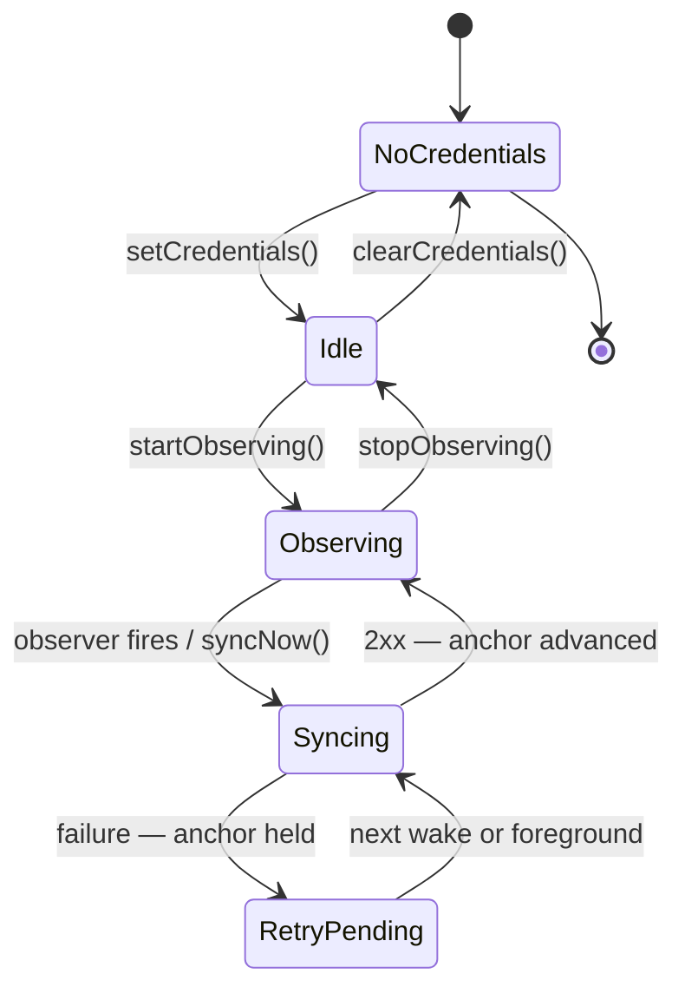
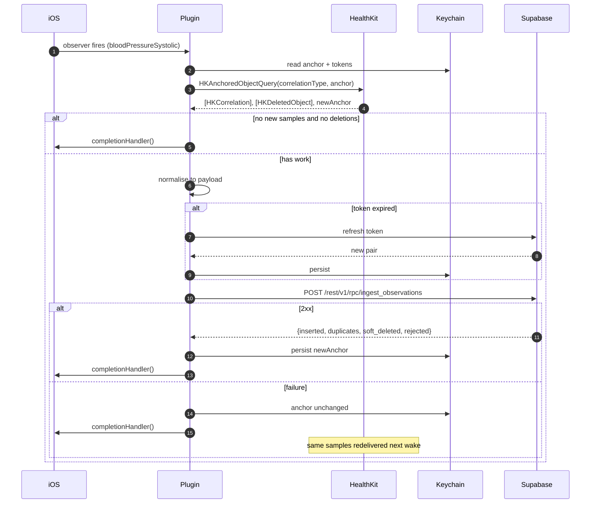

# BP Reset V1 — HealthKit Plugin Bridge Specification

**Status** | Draft — **freeze before Luca's implementation hardens** |
**Owner** | Luca (native), co-authored with Ben |
**Version** | 0.1 |
**Date** | 29 July 2026 |
**Contract refs** | SOW-2026-001 A.3 Deliverables 2 and 3; A.8.2 Stage 2 acceptance |
**Related** | `01-system-architecture.md` §5.1, `02-data-model-and-api.md` §4.2 |

## 1. Why this document exists

Luca builds the plugin in isolation and it is appended to the rest of the system weeks later. Everything in this document is the interface across that gap. Once agreed it changes only by agreement, because a unilateral change here surfaces as an integration failure in the week we can least afford one.

This is also the specification against which Stage 2 acceptance is demonstrated (A.8.2, criteria a–f).

## 2. Responsibility boundary

**The plugin owns:**

- HealthKit authorisation
- Observer query registration and background delivery
- Anchored queries against the correlation type
- Sample normalisation into the ingest payload shape
- **Direct upload to Supabase**, including token refresh
- Anchor persistence

**The plugin does not:**

- store health data on device
- interpret, threshold, classify or annotate any value
- decide what the UI shows
- write anything to Apple Health

The upload responsibility is deliberate. Background delivery wakes the **native** app; the WebView and JS runtime may be suspended or absent. A plugin that emits events to JS and relies on JS to upload will silently drop every background reading, defeating the point of background delivery.

### 2.1 The durability model

There is no local queue. **HealthKit is the queue.**

The plugin advances its `HKQueryAnchor` **only after Supabase returns 2xx**. If the upload fails for any reason — no network, expired token, server error — the anchor is not advanced and the same samples are redelivered on the next wake or foreground sync. Nothing is lost and nothing is stored.

This is the single most important behavioural property of the plugin. It must be true on every code path.


## 3. TypeScript interface

```typescript
export interface CorveoHealthPlugin {
  requestAuthorization(): Promise<AuthorizationResult>;
  getAuthorizationState(): Promise<AuthorizationState>;
  startObserving(): Promise<void>;
  stopObserving(): Promise<void>;
  syncNow(options?: { since?: string }): Promise<SyncResult>;
  getSyncStatus(): Promise<SyncStatus>;
  setCredentials(opts: {
    accessToken: string;
    refreshToken: string;
    userId: string;
    projectUrl: string;
    anonKey: string;
  }): Promise<void>;
  clearCredentials(): Promise<void>;
  addListener(
    event: 'syncCompleted' | 'syncFailed',
    fn: (data: SyncResult | SyncError) => void
  ): Promise<PluginListenerHandle>;
}

export type PermissionState = 'notDetermined' | 'requested' | 'unknown';

export interface AuthorizationResult {
  state: PermissionState;
  requestedTypes: string[];
}

export interface AuthorizationState {
  state: PermissionState;
  lastSuccessfulSyncAt: string | null;
  samplesEverReceived: boolean;
}

export interface SyncResult {
  inserted: number;
  duplicates: number;
  softDeleted: number;
  rejected: number;
  anchorAdvanced: boolean;
  completedAt: string;
}

export interface SyncStatus {
  observing: boolean;
  hasAnchor: boolean;
  hasCredentials: boolean;
  lastSuccessfulSyncAt: string | null;
  lastAttemptAt: string | null;
  lastError: HealthErrorCode | null;
  pendingRetry: boolean;
}

export interface SyncError {
  code: HealthErrorCode;
  retryable: boolean;
  occurredAt: string;
}
```

## 4. The permission-state rule

**The plugin must never report `denied`.**

HealthKit deliberately does not disclose whether read access was refused. Absence of data is indistinguishable from denial, by design, so that an app cannot infer a health condition from a refusal. `HKHealthStore.authorizationStatus(for:)` returns meaningful values for *write* access only; for read types it returns `.sharingDenied` in a way that does not reliably indicate read permission.

Three states only:

| State | Meaning | UI treatment |
|---|---|---|
| `notDetermined` | Authorisation never requested | Show the connect step |
| `requested` | Authorisation requested; outcome unknowable | Normal operation |
| `unknown` | Requested, but no samples have ever arrived | Neutral nudge |

The app treats "authorised but no data after N days" and "denied" **identically**. The nudge copy is neutral and non-diagnostic:

"We haven't seen any readings yet. You can check Corveo's access
in Settings › Health › Data Access & Devices."

Never: "You denied access." We do not know that, and saying so when it isn't true is worse than saying nothing.

This is the rule most likely to be lost in implementation, because the natural instinct is a boolean.

---

## 5. HealthKit types and structure

### 5.1 Types requested

| Purpose | Identifier | Unit |
|---|---|---|
| Read | `HKQuantityTypeIdentifier.bloodPressureSystolic` | `mmHg` |
| Read | `HKQuantityTypeIdentifier.bloodPressureDiastolic` | `mmHg` |
| Read | `HKQuantityTypeIdentifier.heartRate` | `count/min` |
| Read | `HKCorrelationTypeIdentifier.bloodPressure` | correlation |

No write types are requested. `NSHealthUpdateUsageDescription` is not added to Info.plist — requesting a permission we do not use is an avoidable review question.

`NSHealthShareUsageDescription` copy must be education-first and non-diagnostic:

"Corveo reads your blood pressure readings from Apple Health so
your BP Reset program can show them back to you over time."

### 5.2 Observe the part, read the whole

Register the observer query and background delivery against **`bloodPressureSystolic`** as the trigger. On wake, run an `HKAnchoredObjectQuery` against the **correlation type** to fetch the data.

Anchoring on quantity types alone can hand you an orphan systolic without its diastolic, which is unrepresentable in AU Core without inventing a `dataAbsentReason`. Trigger on the part; read the whole.

### 5.3 Three UUIDs per reading — all of them are needed

A BP reading in HealthKit is an `HKCorrelation` with its own `uuid`, containing two `HKQuantitySample` objects each with **their own** `uuid`.

This is not redundancy. `HKAnchoredObjectQuery` returns `HKDeletedObject` instances carrying **only a UUID**, and which UUID you receive depends on which type the deletion was observed against. Store all three:

- correlation `uuid` → `observation.source_uuid`
- each sample `uuid` → `observation_component.source_uuid`

The ingest RPC matches incoming deletions against **either level**. Store only the correlation UUID and deletion handling silently fails for half the cases.

### 5.4 Field extraction

| HealthKit | Payload field | Notes |
|---|---|---|
| `correlation.uuid` | `source_uuid` | Parent dedup key |
| `sample.uuid` | `components[].source_uuid` | Component dedup key |
| `correlation.startDate` | `effective_time` | ISO 8601 UTC |
| `metadata[HKMetadataKeyTimeZone]` | `effective_tz` | IANA name; fall back to device tz |
| `sourceRevision.source.bundleIdentifier` | `source_system` | Prefer over name — stable |
| `sourceRevision.source.name` | `source_name` | Display only |
| `device?.model` | `source_device_model` | Frequently nil; cuffs vary |
| `metadata[HKMetadataKeyWasUserEntered]` | `source_user_entered` | Device-measured vs typed into Health |
| — | `body_site_code` | **Always null.** No standard HealthKit key for cuff arm or posture |

`body_site_code` being permanently null for HealthKit-sourced readings is expected, not a defect. Only manual entry populates it.

## 6. Lifecycle



### 6.1 Registration is a native-launch concern

Background delivery persists across launches and reboots. **Observer queries do not.** They must be re-registered on every app launch, from the native launch path (`application(_:didFinishLaunchingWithOptions:)`), never from JS.

Registering from JS produces a bug that appears only after a device reboot when the user has not opened the app — the hardest possible failure to reproduce and the easiest to ship.

### 6.2 Throttling

iOS throttles observer background wakes; for most sample types the practical floor is roughly hourly regardless of the frequency requested. Request `.immediate`, design for hourly, and never promise near-real-time in UI copy, in documentation, or to Andrew.

### 6.3 Credentials and refresh

JS calls `setCredentials()` after every successful sign-in and token refresh. The plugin persists tokens to Keychain:

- `kSecAttrAccessibleAfterFirstUnlockThisDeviceOnly` — readable during background wakes, excluded from backup
- `kSecAttrSynchronizable = false` — never reaches iCloud Keychain

Background wakes can occur hours after the last foreground, so the access token will routinely be expired. The plugin refreshes autonomously against `POST /auth/v1/token?grant_type=refresh_token`, persists the rotated pair, and proceeds. A failed refresh is a **retryable** error: the anchor is held and `AUTH_REFRESH_FAILED` is surfaced on next foreground.

`clearCredentials()` on logout also clears the anchor. Anchor and credentials are keyed per `userId` so account switching cannot cross-contaminate.


## 7. Sequence — background wake



`completionHandler()` must be called on **every** path, including failure. Not calling it causes iOS to throttle or stop background delivery for the app — a silent, cumulative degradation.


## 8. Error codes

Stable strings. Never free text; never surfaced raw to the patient.

| Code | Retryable | Meaning |
|---|---|---|
| `HEALTHKIT_UNAVAILABLE` | no | Device does not support HealthKit |
| `AUTHORIZATION_NOT_REQUESTED` | no | `startObserving()` before `requestAuthorization()` |
| `NO_CREDENTIALS` | no | `setCredentials()` not called |
| `AUTH_REFRESH_FAILED` | yes | Refresh token rejected or unreachable |
| `NETWORK_UNAVAILABLE` | yes | No connectivity |
| `UPLOAD_REJECTED` | no | 4xx other than 401 — payload problem |
| `UPLOAD_FAILED` | yes | 5xx or timeout |
| `CONSENT_REQUIRED` | no | Server rejected: no active consent |
| `ANCHOR_CORRUPT` | no | Stored anchor failed to unarchive — clear and full re-scan |
| `QUERY_FAILED` | yes | HealthKit returned an error |

Retryable errors hold the anchor and retry on the next trigger. Non-retryable errors hold the anchor and surface to JS via `syncFailed` for the app to handle on next foreground.

## 9. Backfill

On first successful authorisation, the initial anchored query is bounded to **30 days**. Configurable via a build constant; disclosed in the consent copy.

Unbounded backfill would pull potentially years of BP history in one batch — a performance problem and a privacy-posture question we have not asked the patient about.

Subsequent syncs are anchor-driven and unbounded, because the anchor guarantees only unseen samples are returned.

## 10. Anchor loss and reinstall

`HKQueryAnchor` is device-local and archived to Keychain with `ThisDeviceOnly` accessibility, so it does not migrate to a new device. On a new device or reinstall, the anchor is absent and a full 30-day re-scan runs.

This is safe by construction: dedup is keyed on `(user_id, source_system, source_uuid)`, so re-scanned samples land as `duplicates`, not as duplicated rows. Server-side data restores on login independently.

Document this as expected behaviour so it is not later filed as a bug.

## 11. Test matrix (Stage 2 acceptance)

Physical device only. HealthKit background delivery does **not** work in the simulator. Luca needs a companion test app that writes BP correlations into Apple Health so he is not blocked waiting on the loan cuff.

| # | Scenario | Expected | A.8.2 ref |
|---|---|---|---|
| 1 | Authorisation requested, granted | `state: 'requested'` | 2(c) |
| 2 | Authorisation requested, refused | `state: 'requested'`, no `denied` ever returned | 2(c) |
| 3 | Reading on loan cuff → Apple Health → app → Supabase | Row present in Supabase | 2(b), 2(d) |
| 4 | App backgrounded, new reading written | Arrives without opening app | 2(c) |
| 5 | App terminated, device rebooted, new reading | Arrives after observer re-registration | 2(c) |
| 6 | Airplane mode during background wake | Anchor held; delivered on reconnect | — |
| 7 | Expired access token at wake | Refreshed autonomously; upload succeeds | — |
| 8 | Same reading delivered twice | `duplicates: 1`, one row | 2(c) |
| 9 | Reading deleted in Apple Health | Soft-deleted in Supabase, hidden in app | — |
| 10 | Same physical reading from two source apps | Both stored, distinct `source_system` | 2(c) |
| 11 | Manual entry, valid | Row written with `source_type: 'manual'` | 2(a) |
| 12 | Manual entry, systolic 310 | Rejected, mechanical copy only | 2(a) |
| 13 | Logout then login as second user | No cross-contamination; anchor cleared | — |
| 14 | Full build inspection | No interpretation, threshold, colour zone, alert, risk score or heart-age metric present | **2(e)** |

Test 14 is a contractual acceptance criterion, not a formality.

## 12. Explicitly not in V1

- Writing to Apple Health. Would require a second permission and creates a sync-loop risk against dedup. Documented as deliberate — Andrew will ask why the patient's Apple Health doesn't show manual entries.
- Near-duplicate detection between a HealthKit reading and a manual entry of the same physical measurement. Out of scope; stated so.
- Unit conversion. Non-`mm[Hg]` samples are rejected, not converted.
- Any watch-based BP flow. No current Apple Watch measures blood pressure; no flow may imply otherwise.
- Android and Google Health Connect.

## 13. Open items

| # | Item | Owner | Blocks |
|---|---|---|---|
| P-01 | **Freeze this interface with Luca before implementation hardens** | Ben / Luca | Everything |
| P-02 | Companion test app that writes BP correlations | Luca | Test matrix |
| P-03 | Capacitor secure-storage adapter shared between JS and native | Luca / Michael | §6.3 |
| P-04 | Confirm background upload reaching Supabase on wake is acceptable to Andrew | Ben | Stage 2 sign-off |
